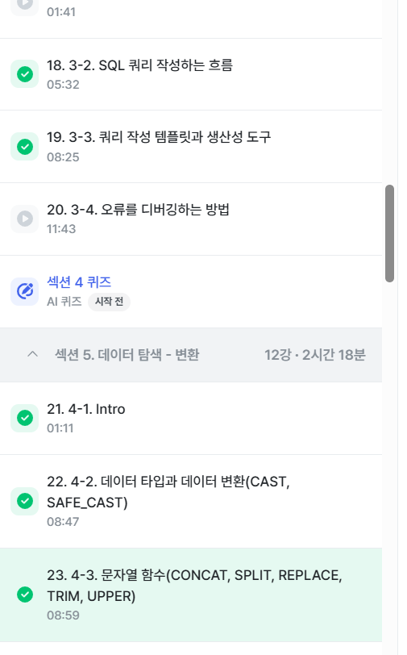
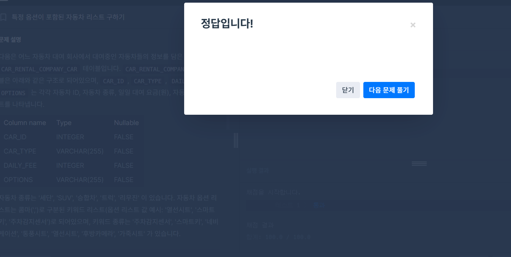
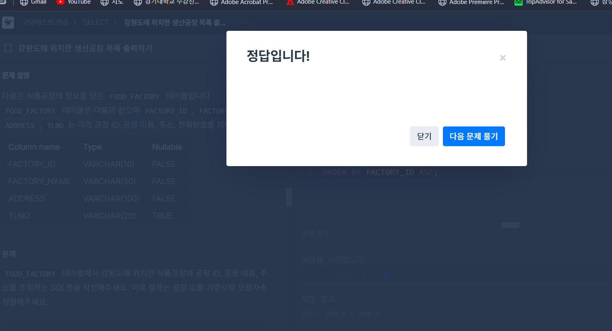
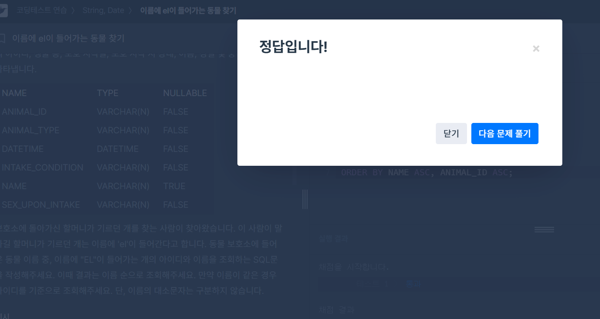
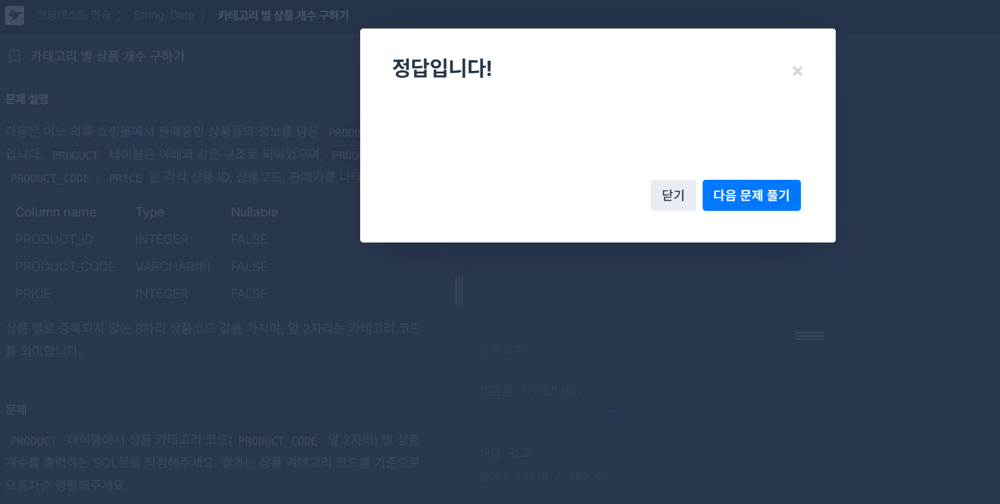

# 📘 SQL_BASIC 4주차 정규 과제

SQL_BASIC 정규 과제는 매주 정해진 분량의 `초보자를 위한 BigQuery(SQL) 입문` 강의를 듣고, 핵심 개념을 정리한 뒤 간단한 SQL 문제를 직접 풀어보는 방식으로 진행합니다.

이번 주는 SQL 쿼리를 작성하는 흐름, 쿼리 작성 템플릿, 데이터 타입 변환, 문자열 함수를 학습합니다.

완성된 과제는 Github에 업로드하고, 링크를 스프레드시트 'SQL' 시트에 입력해 제출해주세요.

**👀 수행 인증란은 필수입니다.**

---

## 📚 SQL_BASIC_4th_TIL

### 섹션 4. SQL 쿼리 잘 작성하기, 쿼리 작성 템플릿 및 오류를 잘 디버깅하기

### 3-2. SQL 쿼리를 작성하는 흐름

### 3-3. 쿼리 작성 템플릿과 생산성 도구

### 섹션 5. 데이터 탐색 - 변환

### 4-1. INTRO

### 4-2. 데이터 타입과 데이터 변환(CAST, SAFE_CAST)

### 4-3. 문자열 함수(CONCAT, SPLIT, REPLACE, TRIM, UPPER)

---

## ✨ 선택 강의

- 3-4. 오류를 디버깅하는 방법: 오류 메시지 해석과 디버깅 흐름을 더 익히고 싶을 때 선택 수강

---

## 🏁 전체 강의 수강 계획

| 주차 | 필수 강의 범위 | 선택 강의 | 완료 여부 |
| --- | --- | --- | --- |
| 1주차 | 1-1 ~ 2-1 | 1 | ✅ |
| 2주차 | 2-2 ~ 2-3 | 2-4 | ✅ |
| 3주차 | 2-5, 2-7 ~ 2-8 | 2-6 | ✅ |
| 4주차 | 3-2 ~ 4-3 | 3-4 | ✅ |
| 5주차 | 4-4 ~ 4-6 | 4-5, 4-7 | 🍽️ |
| 6주차 | 5-2 ~ 5-5 | 5-6 | 🍽️ |
| 7주차 | 필수 강의 없음 | 6-2, 6-3, 6-4, 6-5 | 🍽️ |

---

<br>

<!-- 여기까진 그대로 둬 주세요-->

---

# 1️⃣ 개념 정리

아래 키워드 중 중요하다고 생각한 개념을 2개 이상 골라 짧게 정리해주세요. 3개보다 더 많이 정리하고 싶다면 자유롭게 항목을 추가해도 좋습니다.

이번 주 키워드:
- 쿼리 작성 순서
- 쿼리 작성 템플릿
- 데이터 타입
- CAST
- SAFE_CAST
- CONCAT
- REPLACE
- TRIM

## 01.

```
개념 이름: 쿼리 작성 흐름과 쿼리 작성 템플릿

개념 설명:
SQL 쿼리는 바로 작성하기보다 먼저 어떤 문제를 해결할지와 어떤 지표를 확인할지 정리한 뒤 작성하는 것이 중요하다.
먼저 지표를 고민하고, 추상적이지 않게 구체적인 지표를 정의한 뒤 유사한 문제를 해결한 쿼리나 케이스가 있는지 확인한다.
그다음 데이터를 담고 있는 테이블을 찾고, 테이블이 1개면 그대로 사용하고 2개 이상이면 JOIN 등 연결 방법을 고민한다.
쿼리를 작성한 뒤에는 예상한 결과와 실제 결과가 같은지 확인하고, 마지막으로 나중에 보기 쉽도록 가독성 있게 정리한다.
또한 쿼리 작성 전에 목표, 확인할 지표, 계산 방법, 데이터 기간, 사용할 테이블, JOIN KEY, 데이터 특징을 먼저 메모해두면 쿼리 작성이 더 수월하다.

예시 쿼리:
# 쿼리를 작성하는 목표, 확인할 지표 :
# 쿼리 계산 방법 :
# 데이터의 기간 :
# 사용할 테이블 :
# Join KEY :
# 데이터 특징 :

SELECT
FROM
WHERE
```

## 02.

```
개념 이름: 데이터 타입과 CAST

개념 설명:
데이터 타입에는 숫자, 문자, 시간/날짜, 불리언(Boolean) 등이 있다.
겉으로 보기에는 같은 값처럼 보여도 실제 저장된 타입은 다를 수 있다.
예를 들어 빈 값처럼 보여도 ""일 수도 있고 NULL일 수도 있으며, 1도 숫자 1일 수 있고 문자 "1"일 수도 있다.
또 2023-12-31도 DATE 타입일 수 있고 문자일 수도 있다.
이처럼 내가 생각한 타입과 실제 저장 타입이 다를 경우 타입 변환이 필요하며, 이때 CAST 함수를 사용한다.
CAST는 데이터 타입을 바꾸는 함수이며, 변환이 불가능한 값을 바꾸려고 하면 오류가 발생한다.

예시 쿼리:
SELECT
  CAST(1 AS STRING) AS cast_example;
```

## (선택) 03.

```
개념 이름: 문자열 함수

개념 설명:
문자열 데이터는 붙이기, 나누기, 바꾸기, 잘라내기, 대문자 변환 같은 연산을 할 수 있다.
대표 함수로는 CONCAT, SPLIT, REPLACE, TRIM, UPPER가 있다.
CONCAT은 문자열을 이어 붙이고, SPLIT은 특정 문자를 기준으로 문자열을 나누며, REPLACE는 특정 문자열을 다른 문자열로 바꾼다.
TRIM은 문자열의 특정 부분을 잘라내고, UPPER는 영어 소문자를 대문자로 변환한다.

헷갈린 점:
문자열 함수마다 역할이 다르기 때문에 CONCAT, SPLIT, REPLACE, TRIM의 차이를 구분해서 사용하는 점이 처음에는 헷갈렸다.
```

---

# 2️⃣ 수행 인증란

아래 중 하나 이상을 첨부해주세요.

- 강의 수강 화면 캡처
- 문제 풀이 정답 화면 캡처
- SQL 실행 결과 화면 캡처



---

# 3️⃣ 확인 문제

프로그래머스는 로그인이 필요하므로, 로그인 후 문제 풀이를 진행해주세요.

## 🧩 문제 1

문제 링크: [특정 옵션이 포함된 자동차 리스트 구하기](https://school.programmers.co.kr/learn/courses/30/lessons/157343)

풀이 과정:

```
- 찾으려는 문자열 조건: OPTIONS에 '네비게이션'이 포함된 자동차
- 사용한 문자열 조건 문법: LIKE '%네비게이션%'
- 정렬 기준: CAR_ID 기준 내림차순
```



## 🧩 문제 2

문제 링크: [강원도에 위치한 생산공장 목록 출력하기](https://school.programmers.co.kr/learn/courses/30/lessons/131112)

풀이 과정:

```
- 문제에서 요구한 조건: 강원도에 위치한 식품공장만 조회
- WHERE 절로 옮긴 방식: ADDRESS LIKE '강원도%'로 주소가 강원도로 시작하는 데이터만 필터링
- 정렬 기준: FACTORY_ID 기준 오름차순
```



## 🧩 문제 3

문제 링크: [이름에 el이 들어가는 동물 찾기](https://school.programmers.co.kr/learn/courses/30/lessons/59047)

풀이 과정:

```
- 찾으려는 문자열 패턴: 이름에 'el'이 포함된 개
- 대소문자를 처리한 방식: LOWER(NAME)을 사용해 이름을 소문자로 변환한 뒤 LIKE '%el%' 조건을 적용
- 정렬 기준: NAME 기준 오름차순, 이름이 같으면 ANIMAL_ID 기준 오름차순
```



## 🧩 문제 4

문제 링크: [카테고리 별 상품 개수 구하기](https://school.programmers.co.kr/learn/courses/30/lessons/131529)

풀이 과정:

```
- 추출한 문자열 범위: PRODUCT_CODE의 앞 2자리
- 그룹화 기준: 앞 2자리에서 추출한 CATEGORY
- 정렬 기준: CATEGORY 기준 오름차순
```



---

# 4️⃣ 이번 주 회고

```
1. 쿼리 작성 흐름을 잡을 때 도움이 된 방법:
문제를 보자마자 바로 SELECT를 작성하기보다, 먼저 어떤 문제를 해결할지와 어떤 지표를 확인할지 정리한 뒤 사용할 테이블과 조건을 생각하는 방식이 도움이 되었다.

2. 타입 변환이나 문자열 처리에서 조심해야 할 점:
겉으로 보이는 값과 실제 저장된 데이터 타입이 다를 수 있다는 점을 조심해야 한다.
또한 CAST는 변환이 불가능한 값을 바꾸려고 하면 오류가 발생할 수 있고, 문자열 함수도 각 함수의 역할을 구분해서 사용해야 한다.

3. 앞으로 문제 풀이 때 먼저 확인할 것:
문제에서 요구하는 출력 컬럼, 적용할 조건, 사용할 테이블, 정렬 기준, 문자열 처리나 타입 변환이 필요한지를 먼저 확인하고 쿼리를 작성할 것이다.
```

수고하셨습니다!